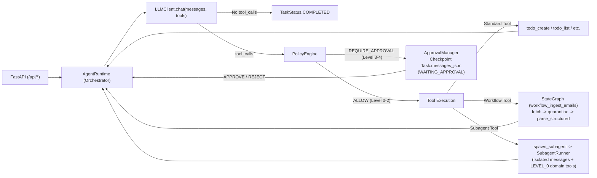

# System Design & Architecture: Sovren

Sovren is a personal admin assistant built on a lightweight, framework-free Python runtime. It combines a native multi-turn Orchestrator loop with semi-deterministic `StateGraph` workflows (for untrusted inputs like email ingestion), isolated `SubagentRunner` delegation, deterministic policy gating, and checkpointed human-in-the-loop approvals.

---

## 1. Core Principles

1. **Native Multi-Turn Orchestrator Loop:** The core runtime (`AgentRuntime`) iterates over native OpenAI tool calls (`while tool_calls -> execute -> repeat`) and terminates cleanly when the LLM returns a final response with no tool calls.
2. **Predefined State Workflows as Named Tools:** Known multi-step procedures requiring strict safety guarantees (such as `email_ingestion`) are modeled using `StateGraph[StateT]` and exposed as named workflow tools (`workflow_ingest_emails`). Untrusted inputs pass through deterministic sanitization (`QuarantineExtractor`) and a zero-tool structured extraction call (`LLMClient.parse_structured`).
3. **Scoped Subagents for Context & Privilege Isolation:** When a task benefits from an isolated context window or restricted permissions, the orchestrator calls the `spawn_subagent` tool for a specific domain. `SubagentRunner` runs an ephemeral loop with a fixed `DEFAULT_SUBAGENT_PROMPT` and only that domain's read-only (`RiskLevel.LEVEL_0`) tools, returning only the distilled summary to the Orchestrator.
4. **Deny-by-Default Policy & Checkpointed Approvals:** Unregistered tools are denied by default. Levels 0–2 execute automatically; Levels 3–4 (`email_send`, external side effects) checkpoint the Orchestrator's short-term working memory (`Task.messages_json`) in SQLite and pause in `WAITING_APPROVAL`. When approved or rejected, the tool result is appended to `messages_json` and the Orchestrator resumes seamlessly.
5. **Unified `Tool` Abstraction & Naming Convention:** Atomic tools, `StateGraph` pipelines, and `spawn_subagent` all share the same `Tool` interface and pass through the same policy/approval gateway, distinguished by a consistent naming convention:
   - **Read tools (`LEVEL_0`):** `<domain>_<read_verb>` (`list`, `get`, `search`) — e.g. `todo_list`
   - **Action / write tools (`LEVEL_2+`):** `<domain>_<action_verb>` (`create`, `update`, `delete`, `send`) — e.g. `todo_create`, `email_send`
   - **Pipeline / workflow tools:** `workflow_<name>` — e.g. `workflow_ingest_emails`
   - **Subagent spawner:** `spawn_subagent`

---

## 2. System Flow

---

## 3. Core Modules

### A. Domain Models & Persistence (`backend/app/core/`, `backend/app/db/`)

- **Core Enums & Schemas (`core/models.py`):**
  - `TaskStatus`: `QUEUED`, `EXECUTING`, `WAITING_APPROVAL`, `COMPLETED`, `FAILED`.
  - `RiskLevel`: `LEVEL_0` (read) through `LEVEL_4` (payment).
- **SQLite WAL Tables (`db/models.py`, `db/database.py`):**
  - `tasks`: Top-level agent run record with `id`, `source_type`, `status`, `context_json`, `messages_json` (short-term working memory checkpoint), and `result_json`.
  - `approvals`: Pending and resolved tool approvals (`task_id`, `tool_call_id`, `tool_name`, `proposed_args_json`, `status`, `resolved_by`, `resolved_at`).
  - `audit_log`: Append-only execution and policy audit records (`task_id`, `approval_id`, `event_type`, `tool_name`, `risk_level`, `policy_decision`, `actor`, `payload_json`).

### B. Orchestrator, State Workflows & Subagents (`backend/app/runtime/`)

- **`AgentRuntime` (`runtime/agent.py`):** Main Orchestrator owning the `while` tool-calling loop, `Task.messages_json` checkpointing, and `resume_after_approval`.
- **`StateGraph` (`runtime/workflow.py`):** Lightweight semi-deterministic state machine supporting sequential edges (`add_edge`), conditional routing (`add_conditional_edge`), SSE `workflow_step` events, and `.as_tool()` wrapping.
- **`SubagentRunner` (`runtime/subagent.py`):** Isolated subagent loop with an ephemeral `messages` history and scoped `PolicyEngine`, invoked dynamically via `build_spawn_subagent_tool()` (`spawn_subagent`) using domain-filtered `LEVEL_0` tools.
- **Tool Runner & State Helpers (`runtime/tool_runner.py`, `runtime/state.py`):** Evaluates individual tool calls against `PolicyEngine`, executes allowed tools, queues approvals, writes `AuditLog` entries, and persists task transitions.

### C. Quarantine & Predefined Feature Workflows (`backend/app/quarantine/`, `backend/app/features/`)

- **`QuarantineExtractor` (`quarantine/extractor.py`):** Deterministically strips untrusted HTML/scripts and normalizes `SanitizedEmail` payloads.
- **`email_ingestion` Workflow (`features/email_triage.py`):** A 3-node `StateGraph[EmailIngestionState]` (`fetch_emails` $\rightarrow$ `quarantine_sanitize` $\rightarrow$ `extract_digest`) exposed as the `workflow_ingest_emails` tool (`RiskLevel.LEVEL_0`). The `extract_digest` node uses `LLMClient.parse_structured` with zero tools so untrusted email bodies cannot trigger tool execution.

### D. Policy Engine, Approvals & Tool Gateway (`backend/app/policy/`, `backend/app/approval/`, `backend/app/tools/`)

- **`PolicyEngine` (`policy/engine.py`):** Deterministic evaluator mapping `ProposedToolCall` to `ALLOW` (Levels 0–2), `REQUIRE_APPROVAL` (Levels 3–4), or `DENY`.
- **`ApprovalManager` (`approval/manager.py`):** Persists `PENDING` approvals with `tool_call_id`, resolves `APPROVE` / `REJECT` actions, appends the `role: "tool"` outcome to `Task.messages_json`, and emits SSE updates before `AgentRuntime.resume_after_approval` resumes the loop.
- **`Tool` Registry (`tools/registry.py`, `tools/tools.py`, `tools/builtin.py`):** Validates arguments against each tool's Pydantic schema and executes sync/async callables.
