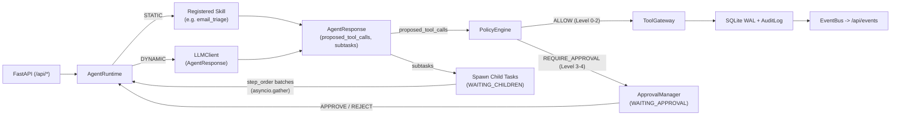

# System Design & Architecture: Sovren

Sovren is a personal admin assistant built on a lightweight, framework-free Python runtime. It combines structured task-graph orchestration (`STATIC` skill pipelines and `DYNAMIC` subtask planning) with deterministic policy gating and human-in-the-loop approvals for external side effects.

---

## 1. Core Principles

1. **Tools Are Proposed, Never Executed Directly:** The LLM proposes `ProposedToolCall`s and receives tool schemas only—never credentials or direct tool access. Every tool call passes through the deterministic `PolicyEngine` and `ToolGateway`.
2. **Dynamic Graph Planning Without Extra Friction:** In `DYNAMIC` mode, the LLM can structure multi-step work by returning `SubTask` items (`step_order`, `execution_mode`, `static_module`, `skill_name`, `context`). Spawning subtasks is treated as control-flow planning (bounded by `max_depth`), while human approval is reserved strictly for high-risk tool calls.
3. **Deny-by-Default Policy:** Unregistered tools are denied by default. Internal reads/staging/mutations (Levels 0–2) run automatically; external side effects and payments (Levels 3–4) pause for human approval.
4. **Crash-Safe Persistence:** Tasks, task hierarchy, approvals, and append-only audit entries live in SQLite (WAL mode) so paused tasks (`WAITING_APPROVAL`, `WAITING_CHILDREN`) can resume cleanly via API calls.

---

## 2. System Flow

---

## 3. Core Modules

### A. Domain Models & Persistence (`backend/app/core/`, `backend/app/db/`)

- **Core Enums & Schemas (`core/models.py`):**
  - `TaskStatus`: `QUEUED`, `EXECUTING`, `WAITING_APPROVAL`, `WAITING_CHILDREN`, `COMPLETED`, `FAILED`.
  - `ExecutionMode`: `STATIC` (runs a registered Python execution module) or `DYNAMIC` (LLM plans tool calls and/or `SubTask`s, optionally guided by a future `SKILL.md` via `skill_name`).
  - `RiskLevel`: `LEVEL_0` (read) through `LEVEL_4` (payment).
  - `AgentResponse`: `message`, `proposed_tool_calls: list[ProposedToolCall]`, `subtasks: list[SubTask]`.
- **SQLite WAL Tables (`db/models.py`, `db/database.py`):**
  - `tasks`: Hierarchical task node with `id`, `parent_task_id`, `root_task_id`, `step_order`, `execution_mode`, `static_module`, `skill_name`, `source_type`, `status`, `context_json`, `result_json`, and self-referential `parent` / `children` relationships.
  - `approvals`: Pending and resolved tool approvals (`task_id`, `tool_name`, `proposed_args_json`, `status`, `resolved_by`, `resolved_at`).
  - `audit_log`: Append-only execution and policy audit records (`task_id`, `approval_id`, `event_type`, `tool_name`, `risk_level`, `policy_decision`, `actor`, `payload_json`).

### B. Hierarchical Orchestrator (`backend/app/runtime/agent.py`)

`AgentRuntime` drives task execution and child-graph coordination:

- **Static Execution (`ExecutionMode.STATIC`):** Dispatches to a registered Python module via `static_module` (`register_static_module(name, handler)`), such as `email_triage`.
- **Dynamic Execution (`ExecutionMode.DYNAMIC`):** Calls `LLMClient.generate_structured(..., response_model=AgentResponse)` to propose tool calls and/or `SubTask`s (`skill_name` is reserved for future `SKILL.md`-driven dynamic skills).
- **Step-Order Graph Execution:**
  - Child `Task`s are stored as `QUEUED` with `parent_task_id`, inherited `root_task_id`, and integer `step_order`.
  - `_run_next_step_group` executes all `QUEUED` children sharing the lowest `step_order` concurrently via `asyncio.gather` (using an isolated `AsyncSession` per child coroutine).
  - When a `step_order` batch completes, the next `step_order` batch starts with prior step outputs injected into `context_json["prior_results"]`.
  - Once all children finish, `_finalize_parent` aggregates child results into `parent_task.result_json` (failing the parent if any child failed) and cascades upward if the parent itself has a parent.
- **Guards & Resumption:** `max_depth` (default `5`) prevents runaway dynamic recursion; `resume_after_approval(session, task_id)` resumes child batches or parent rollups once an approval resolves.

### C. Quarantine & Feature Skills (`backend/app/quarantine/`, `backend/app/features/`)

- **`QuarantineExtractor` (`quarantine/extractor.py`):** Deterministically strips untrusted HTML/markup and extracts structured `SanitizedEmail` data using an isolated LLM call with zero tools registered.
- **`EmailTriagePipeline` / `email_triage_module` (`features/email_triage.py`):** Static execution module registered on `AgentRuntime` as `"email_triage"` that sanitizes inbound email and proposes triage actions as an `AgentResponse`.

### D. Policy Engine, Approvals & Tool Gateway (`backend/app/policy/`, `backend/app/approval/`, `backend/app/tools/`)

- **`PolicyEngine` (`policy/engine.py`):** Pure Python evaluator mapping `ProposedToolCall` to `PolicyAction`:
  - `ALLOW`: Levels 0–2 (`create_task`, internal reads/staging).
  - `REQUIRE_APPROVAL`: Levels 3–4 (`send_email`, external side effects/payments).
  - `DENY`: Unknown/unregistered tools or risk levels.
- **`ApprovalManager` (`approval/manager.py`):** Persists `PENDING` approvals, handles `APPROVE` / `REJECT` resolutions, executes approved tools via `ToolGateway`, records outcomes in `task.result_json` and `audit_log`, and transitions the task to `WAITING_CHILDREN` (if queued children exist), `COMPLETED`, or `FAILED`.
- **`ToolGateway` (`tools/registry.py`, `tools/builtin.py`):** Registry validating arguments against each tool's Pydantic schema before executing tool functions (`create_task`, `send_email`).

### E. API & Real-Time Events (`backend/app/api/`, `backend/app/events/`)

- **REST Endpoints (`api/router.py`):**
  - `POST /api/tasks/ingest-email`: Creates a root `STATIC` (`email_triage`) task and runs it.
  - `POST /api/approvals/{approval_id}/resolve`: Resolves an approval (`APPROVE` / `REJECT`) and triggers `AgentRuntime.resume_after_approval`.
  - `GET /api/tasks`, `GET /api/approvals`, `GET /api/audit`: Query current state and audit history.
- **SSE Stream (`events/bus.py`, `GET /api/events`):** Publishes `task_updated`, `approval_requested`, `approval_resolved`, and `audit_logged` events in real time.
