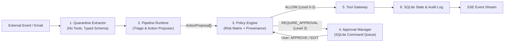

# System Design & Architecture: Sovren

Sovren is a personal assistant that takes care of your everyday admin so you can focus on what matters.

It handles your email, calendar, tasks, and daily briefings, alerting you only when something important comes up. Routine, well-established tasks run on their own within rules you set; anything new or high-impact waits for your approval. Over time, Sovren expands to handle broader personal tasks—like browsing the web to book tickets and coordinating directly agent-to-agent with teammates and other Sovren users.

---

## 1. Product Vision & Boundaries

- **Core Purpose:** Act as a trusted personal assistant for everyday life and administration—starting with email triage, calendar scheduling, task tracking, and daily briefings, and expanding into broader personal workflows. Sovren is a personal assistant, not a coding agent or a developer orchestration framework.
- **Core Principle — Safety by Design, Not Prompt Engineering:** The LLM acts strictly as a _proposer_. It never holds credentials, network access, or direct tool execution capabilities. A deterministic platform layer enforces policy, manages human-in-the-loop approvals, and executes tools.
- **Product Boundaries (What Sovren Does Not Do):**
  - **No Shell or Code Execution:** A personal assistant has no need for autonomous terminal access or arbitrary code execution.
  - **No Unconstrained Autonomous Loops:** Workflows are step-bounded and policy-gated at every external side effect.
  - **No Enterprise IT / Direct Hosting:** No enterprise SSO/organization admin suites and no direct email/calendar server hosting (integrates with existing providers via adapters).
- **Roadmap Capabilities (Core Vision, Post-V1 Foundation):**
  - **Agent-to-Agent Coordination:** Coordinating meetings, availability, and shared tasks directly with other Sovren agents under strict privacy and permission boundaries.
  - **Guided Web & Booking Workflows:** Controlled web-browsing workflows to research and book tickets, travel, or reservations, pausing at Level 3 approval before any transaction or commitment.
  - **Expanded Assistant Skills:** Incrementally adding everyday personal assistant integrations on top of the same deterministic policy and approval core.

---

## 2. Core V1 Product Capabilities

1. **Inbox Triage & Assisted Replies:**
   - Classify incoming emails by urgency, category, and required action.
   - Generate reply proposals presented as interactive approval cards (`Approve`, `Edit`, `Reject`).
2. **Scheduling & Calendar Coordination:**
   - Extract meeting requests from inbound emails, cross-reference calendar free/busy slots, and propose calendar invites or reply options.
3. **Task & Kanban Management:**
   - Extract actionable to-dos from emails or direct user commands into structured tasks (`pending`, `waiting_approval`, `completed`, `failed`).
4. **Daily Briefing & Priority Alerts:**
   - Summarize daily schedule, high-priority tasks, and pending approvals while respecting user-configured quiet hours.

---

## 3. System Architecture

Sovren uses a custom, framework-free Python runtime built around deterministic event pipelines and a deny-by-default policy gateway.

### A. Architectural Invariants

1. **LLM as Proposer Only:** LLM stages receive structured context and emit strongly-typed Pydantic outputs (`ActionProposal`). They cannot invoke tools or access credentials.
2. **Bounded Pipelines over Open-Ended Loops:** V1 workflows follow structured, step-bounded pipelines (`Ingest -> Quarantine -> Triage & Propose -> Policy Gate -> Approve/Execute`) rather than unconstrained autonomous loops, guaranteeing predictable latency, cost, and safety.
3. **Deny-by-Default Interception:** Every proposed tool call is evaluated by the deterministic Policy Engine before execution.
4. **Provenance-Bound Context:** Pipelines attach an immutable `ExecutionContext` (e.g., source trigger type, original sender, thread ID) that the Policy Engine uses to prevent confused-deputy and indirect prompt injection attacks.
5. **Crash-Safe Persistence:** Tasks, pending approvals, and append-only audit logs are persisted immediately in SQLite (WAL mode). Pending approvals require no in-memory coroutine state to resume after a restart.

---

### B. Core Subsystems

#### 1. Quarantine Ingestion (`backend/app/quarantine/`)

- **Objective:** Normalize untrusted external payloads (emails, calendar invites) and reduce prompt injection surface area before downstream reasoning.
- **Mechanism:**
  - Deterministic pre-processing strips HTML, scripts, hidden markup, and excessive length.
  - An isolated extraction LLM step with **zero tool schemas registered** extracts structured data into strict Pydantic models (`SanitizedEmail`, `ExtractedMeetingRequest`).
- **Defense-in-Depth Note:** Because free-text summaries in `SanitizedEmail` can still carry adversarial instructions, downstream actions are constrained by provenance rules in the Policy Engine.

#### 2. Pipeline Runtime (`backend/app/runtime/`)

- **Objective:** Coordinate bounded, single-purpose LLM stages and route resulting `ActionProposal` batches to the Policy Engine.
- **Workflow Paradigms:**
  - **Event-Driven Pipeline (e.g., Inbound Email):** `QuarantineExtract -> TriageAndPropose -> Policy Evaluation -> Auto-Execute (Levels 0–2) & Queue Approvals (Level 3)`.
  - **Interactive Command Pipeline:** `User Instruction -> IntentAndActionPropose -> Policy Evaluation -> Auto-Execute or Queue Approval`.
- **Task Lifecycle States:**
  - `PENDING`: Ingested and queued for processing.
  - `PROCESSING`: Executing quarantine and triage/proposal stages.
  - `WAITING_APPROVAL`: One or more Level 3 action proposals are paused awaiting user resolution.
  - `EXECUTING`: Policy-cleared tool calls are running via the Tool Gateway.
  - `COMPLETED` / `FAILED`: Terminal states persisted in SQLite and broadcast via SSE.
- **LLM Provider Protocol (`backend/app/runtime/llm.py`):**
  - Narrow `LLMProvider` interface (`generate_structured(system_prompt, user_prompt, response_model: type[T]) -> T`) backed by a single primary SDK provider in V1 and a deterministic `MockLLMProvider` for automated testing.

#### 3. Deterministic Policy Engine (`backend/app/policy/`)

- **Objective:** Enforce safety invariants using pure Python rules over structured metadata: `(tool_name, args, risk_level, execution_context, trust_rules)`.
- **Risk Level Matrix:**
  - **Level 0 (Read):** Auto-approved (e.g., `get_calendar_free_busy`, `read_thread`).
  - **Level 1 (Stage/Prepare):** Auto-approved with logging; non-external staging only (e.g., `save_external_draft`).
  - **Level 2 (Internal State Mutation):** Auto-approved with audit logging (e.g., `create_task`, `update_task_status`).
  - **Level 3 (External Side Effect):** Returns `REQUIRE_APPROVAL` unless matched by an explicit user trust rule (e.g., `send_email`, `create_calendar_invite`, `delete_event`).
- **Provenance & Trust Checks:**
  - Replies triggered by an inbound email must match the source thread/sender unless explicitly overridden by the user.
  - Evaluates explicit email and domain allowlists.

#### 4. Approval Manager (`backend/app/approval/`)

- **Objective:** Manage human-in-the-loop gating as a persistent, idempotent command queue.
- **Operation:**
  - When the Policy Engine returns `REQUIRE_APPROVAL`, the proposal is written to the `approvals` table (`status='pending'`) with a unique `approval_id` and `idempotency_key`, and an `approval_card` SSE event is emitted.
  - **Resolutions (`APPROVE`, `EDIT`, `REJECT`):**
    - `APPROVE`: Atomically transitions approval status `pending -> executing`, invokes the Tool Gateway, and updates the parent task state.
    - `EDIT`: Validates user-modified parameters against the tool's Pydantic schema, re-verifies with the Policy Engine, logs both original and edited parameters (`actor="user_edited"`), and executes.
    - `REJECT`: Marks approval `rejected`, records the decision in `audit_log`, and transitions the parent task accordingly.

#### 5. Tool Execution Gateway (`backend/app/tools/`)

- **Objective:** Execute policy-cleared tools with server-injected credentials and provider abstraction.
- **Isolation:** Tool functions execute pure Python logic using server-side credentials. LLM prompts only ever receive tool names and parameter JSON schemas.
- **Provider Protocols:** External integrations implement typed interfaces (`EmailProvider`, `CalendarProvider`, `TaskProvider`), enabling seamless switching between in-memory mocks (for local development and tests) and OAuth-backed production providers.

#### 6. Persistence, Audit Log & Event Stream (`backend/app/db/`, `backend/app/events/`)

- **SQLite Configuration:** Uses `aiosqlite` / SQLModel with `PRAGMA journal_mode=WAL;`, `PRAGMA busy_timeout=5000;`, and `PRAGMA foreign_keys=ON;`.
- **Core Tables:**
  - `tasks`: `id`, `source_type`, `status`, `context_json`, `created_at`, `updated_at`.
  - `approvals`: `id`, `task_id`, `tool_name`, `proposed_args_json`, `edited_args_json`, `status` (`pending`, `executing`, `approved`, `rejected`, `failed`), `resolved_by`, `created_at`, `resolved_at`.
  - `audit_log`: Append-only table recording `id`, `task_id`, `approval_id`, `event_type`, `tool_name`, `risk_level`, `policy_decision`, `actor` (`system`, `policy_auto`, `user_approved`, `user_edited`, `user_rejected`), `payload_json`, `created_at`.
- **State Sync & SSE (`GET /api/events`):**
  - Frontend hydrates state on load via REST (`GET /api/tasks`, `GET /api/approvals`, `GET /api/audit`) and subscribes to `/api/events` for live SSE deltas (`task_updated`, `approval_requested`, `approval_resolved`, `audit_logged`).

---

## 4. Implementation Milestone 1: Core Control Loop & Vertical Slice

### Objective

Build and verify the complete, framework-free control loop end-to-end using SQLite persistence, deterministic policy enforcement, and mock providers—without external OAuth or cloud dependencies.

### Sequenced Deliverables

1. **Core Schemas & Protocols (`backend/app/core/`):**
   - Define `RiskLevel`, `ExecutionContext`, `ActionProposal`, `PolicyDecision`, `ToolResult`, `SanitizedEmail`, and SSE event envelopes.
   - Define `LLMProvider`, `EmailProvider`, and `TaskProvider` protocols.
2. **SQLite Storage & Audit Repository (`backend/app/db/`):**
   - Configure async SQLite engine with WAL mode.
   - Implement schema and repositories for `tasks`, `approvals`, and append-only `audit_log`.
3. **Deterministic Policy Engine (`backend/app/policy/`):**
   - Implement risk matrix (Levels 0–3), recipient/domain allowlist evaluation, and inbound email provenance checks.
4. **Tool Gateway & Mock Providers (`backend/app/tools/`):**
   - Implement tool registry with schema validation and mock tools: `create_task` (Level 2) and `send_email` (Level 3).
5. **Persistent Approval Manager (`backend/app/approval/`):**
   - Implement `request_approval()` and idempotent `resolve_approval(approval_id, action, edited_args)` supporting `APPROVE`, `EDIT`, and `REJECT`.
6. **Quarantine & Pipeline Runtime (`backend/app/quarantine/`, `backend/app/runtime/`):**
   - Implement `QuarantineExtractor` and `EmailTriagePipeline` using `LLMProvider` (with both a `MockLLMProvider` for deterministic tests and one live LLM SDK adapter).
7. **FastAPI REST & SSE Layer (`backend/app/api/`):**
   - `POST /api/tasks/ingest-email`: Ingest a synthetic email to trigger the pipeline.
   - `POST /api/approvals/{id}/resolve`: Approve, edit, or reject a pending Level 3 action.
   - `GET /api/tasks`, `GET /api/approvals`, `GET /api/audit`: State inspection endpoints.
   - `GET /api/events`: SSE stream for real-time state transitions.
8. **End-to-End Verification Suite (`backend/tests/`):**
   - **Happy-Path & Split-Risk Test:** Ingest synthetic email $\rightarrow$ Quarantine extracts `SanitizedEmail` $\rightarrow$ Triage proposes `create_task` (Level 2) + `send_email` (Level 3) $\rightarrow$ `create_task` auto-executes and logs $\rightarrow$ `send_email` pauses in `WAITING_APPROVAL` $\rightarrow$ User resolves with `EDIT` / `APPROVE` $\rightarrow$ `send_email` executes $\rightarrow$ Task reaches `COMPLETED` with full audit trail.
   - **Crash/Restart Persistence Test:** Pause a task in `WAITING_APPROVAL`, re-instantiate the application/runtime against the same SQLite file, resolve the approval, and verify completion.
   - **Injection / Provenance Block Test:** Verify that an inbound email from `alice@example.com` attempting to trigger `send_email` to `attacker@evil.com` is deterministically blocked or flagged by the Policy Engine.
